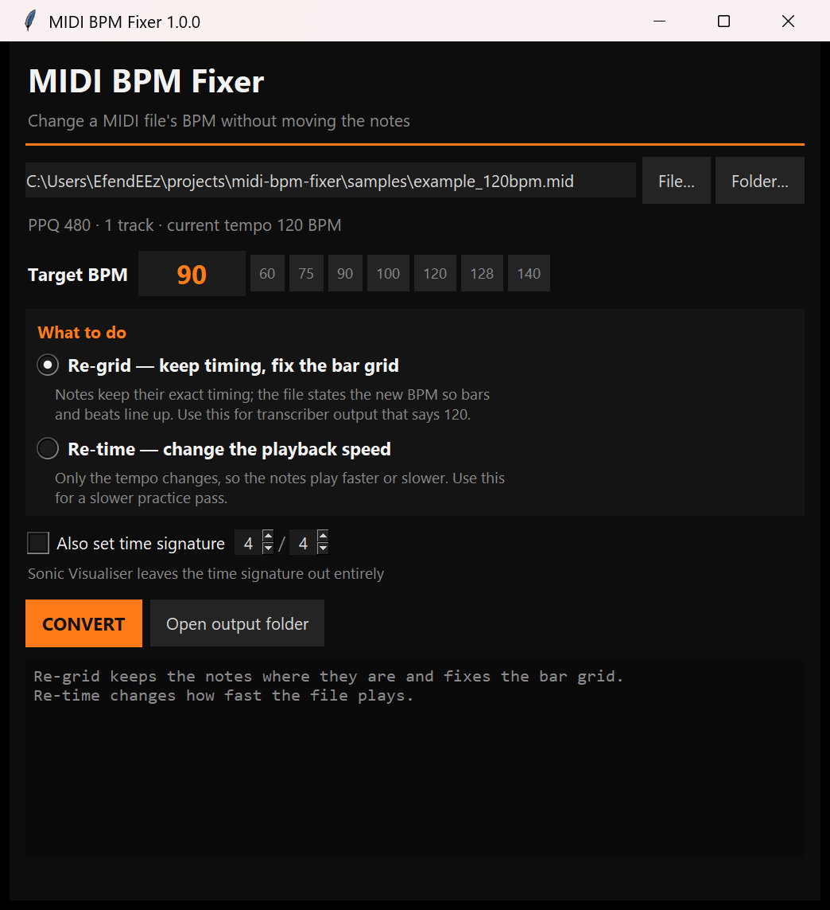

# MIDI BPM Fixer

**Change a MIDI file's BPM without moving the notes.** A tiny Windows tool that fixes the
"everything exports at 120 BPM" problem — for Sonic Visualiser, Tony, AI audio-to-MIDI
transcribers, and anything else that stamps a fixed tempo on note data.



---

## The problem this solves

Most transcription tools export note layers as a MIDI file with **no tempo information at
all**, which means the file reads as the MIDI default of **120 BPM** no matter what the song
actually is. Import that into your DAW, notation app, or SynthV project and:

- the bar lines land in the wrong place
- notes drift out of the grid even though they sound at the right moments
- you can't quantise, because the grid itself is wrong

The usual fix you'll find online — "just rewrite the tempo event" — changes the playback
speed instead, which is worse.

## Two things called "change the BPM"

| | What it does | Use it when |
|---|---|---|
| **Re-grid** (default) | File states the new BPM **and** every tick is rescaled, so notes still sound at the same moments. The bar grid now matches the music. | A transcriber stamped 120 on a song that's really 87. |
| **Re-time** | Only the tempo event changes, so the notes play faster or slower. | You want a slower pass to practise along to. |

`ticks_per_beat` (PPQ) is **never** touched — it stays at whatever the source used, because
some DAWs and notation apps assume 480 or 960. Pitches, velocities, channels, controllers and
existing note lengths all carry through unchanged.

## Use it

### Download

Grab `MIDI BPM Fixer.exe` from [Releases](../../releases). No Python needed — it's a single
file, no installer, no admin rights.

### In the window

1. **File…** (or **Folder…** for a batch, or drop a `.mid` on the .exe)
2. Type the real BPM, or click a preset
3. Leave **Re-grid** selected
4. **CONVERT**

Output lands next to the input as `song_bpm90.mid`. The original is never modified or
overwritten.

### From the command line

```
midi-bpm-fixer.exe --bpm 90 song.mid            # re-grid one file
midi-bpm-fixer.exe --bpm 90 folder\             # re-grid every .mid in a folder
midi-bpm-fixer.exe --bpm 110 --mode retime song.mid
midi-bpm-fixer.exe --bpm 90 --time-sig 3/4 song.mid
midi-bpm-fixer.exe --selftest                   # run the built-in verification
```

## Verified, not assumed

`--selftest` builds a synthetic 120 BPM file with notes at 0.0 / 0.5 / 1.0 s, converts it,
and reads the result back through mido's tempo-aware playback iterator:

```
[ok] regrid: onsets unchanged in seconds          max drift 0.00000s
[ok] regrid: tempo event is 90 BPM                [666667]
[ok] regrid: PPQ untouched                        480
[ok] regrid: ticks scaled to 0/360/720            [0, 360, 720]
[ok] retime: plays 4/3 slower                     [0.0, 0.667, 1.333]
[ok] retime: ticks untouched                      [0, 480, 960]
[ok] sv: tempo event inserted                     [600000]
[ok] sv: onsets unchanged (0/.5/1.0)              [0.0, 0.5, 1.0]
[ok] time signature written                       [(3, 4, 0)]
[ok] second run does not overwrite                test120_bpm90_3.mid
```

## What it deliberately doesn't do

- **No audio time-stretching.** MIDI only — this edits note data, it doesn't touch sound.
- **No tempo maps.** A file that changes tempo mid-song is converted using its first tempo;
  the tool says so in the output rather than silently mangling the rest.
- **No quantisation.** It fixes the grid; snapping notes onto it is a separate job.

## Build from source

```
pip install mido
python midi_bpm_fixer.py            # opens the window
python midi_bpm_fixer.py --selftest # checks
```

Windows `.exe`:

```
python -m pip install mido pyinstaller pillow
build_exe.bat
```

Needs Python 3.9+ and Tk (bundled with the python.org Windows installer).

## Licence

MIT. See [LICENSE](LICENSE).

## Keywords

MIDI · BPM · tempo · bpm changer · change midi bpm · midi tempo · Sonic Visualiser · Tony ·
SynthV · Synthesizer V · Vocaloid · UTAU · transcription · quantization · music production
